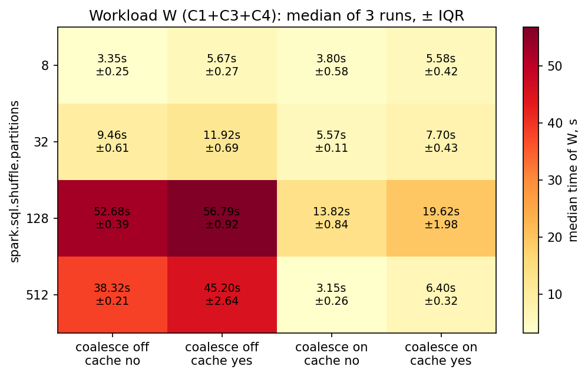
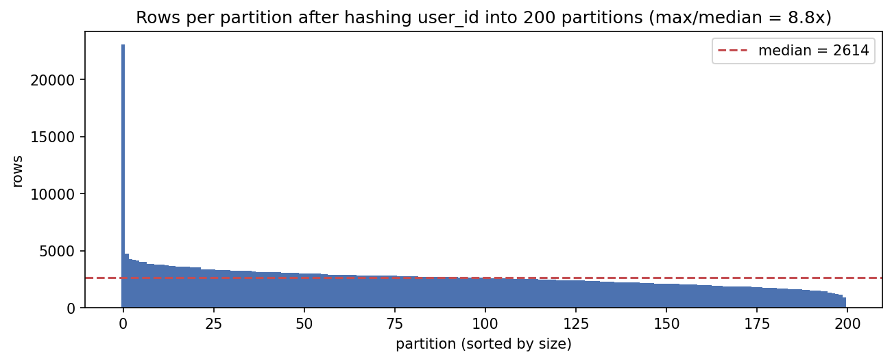

# ShopStream at Scale — Distributed Batch Analytics with PySpark

A Spark batch layer for a dirty e-commerce clickstream (**2.8M events, 60 days, 30k users**):
raw JSON → data-quality rules and quarantine → partitioned Parquet silver table → analytics
(funnel, sessionization, top products, DAU/WAU) → a performance study of storage layout, joins under skew, AQE and scaling.
Every timing is the median of 3 runs after a warm-up, and every claim is backed by a query plan, a checksum or a brute-force check.

> Course project (Big Data, MSc Applied AI, Astana IT University) — graded **96/100**.
> Full write-up with plots and annotated query plans: [`report/report.pdf`](report/report.pdf).

## Key findings

| | Finding | Evidence |
|---|---|---|
| **Shuffle-file count, not CPU, was the bottleneck.** With 128 shuffle partitions and no AQE coalescing the workload took 52.7 s; disabling Spark's bypass-merge shuffle writer brought it to 8.6 s (**6.1×**). AQE coalescing removes most of the penalty automatically. | `results/E1_grid.csv`, `results/E1b_bypass_check.csv` |
| **One bot account skews both metrics and performance.** It is 3.85% of all events and 1,772× the median user, producing a 9.1× max/median partition skew. It was detected from the data (99.9th percentiles + no cart activity), with no hard-coded id. | `results/B_bot_summary.csv`, `results/D1_*` |
| **Broadcast beats every skew fix locally.** Broadcast hash join was 7.7× faster than sort-merge. AQE skew join (proven by `SortMergeJoin(skew=true)` in the final plan) and salting with N ∈ {4, 16, 64} returned identical checksums but did not pay off at this scale. The report explains why local mode hides the skew penalty. | `results/D2_join_matrix.csv`, `results/D2_plan_*.txt` |
| **Layout pays on every query.** An explicit schema reads 10× faster than inference. Date-partitioned Parquet answers a weekly revenue query 5× faster than raw JSON. A naive write produces 16 files/day and +33% storage. | `results/A1_*`, `results/A2_*`, `results/A3_*` |
| **Amdahl serial fraction s ≈ 0.26** (max ~3.9× speed-up). 8 and 16 logical cores perform the same. | `results/E2_scaling.csv` |

<p align="center">
  
  
</p>

## What is inside

| Part | Content |
|---|---|
| **A** Ingestion & layout | schema inference vs explicit schema; 3 silver write strategies incl. a size-balanced one (1–4 files/day); partition pruning & pushdown (JSON vs flat vs partitioned Parquet) |
| **B** Data quality | rules R1–R6 in pure Spark, all reasons kept in a `dq_reasons` array; dedup keeps the earliest copy; mandatory reconciliation `raw = silver + quarantine + duplicates`; data-driven bot flag `is_bot` |
| **C** Analytics | daily funnel & GMV, 30-min sessionization (`lag` + running sum), top-5 products per category/week (`dense_rank`), DAU/WAU via `sequence` + `explode` — each written **twice** (DataFrame API and Spark SQL) and asserted equal |
| **D** Joins & skew | key distribution and per-partition counts, Spark UI evidence; broadcast vs sort-merge vs AQE skew join vs salting of programmatically detected hot keys, checked with an order-independent checksum |
| **E** Benchmarks | shuffle partitions × AQE coalescing × cache grid (median ± IQR), scaling over `local[1..16]` with an Amdahl fit, and a follow-up experiment that explains an anomaly in the grid |

## Run it

Requirements: Python 3.11, Java 17. On Windows you also need `winutils.exe` + `hadoop.dll` (Hadoop 3.3.x) in `C:\hadoop\bin`.

```bash
python -m venv .venv && source .venv/bin/activate      # Windows: .venv\Scripts\activate
pip install -r requirements.txt
python run_a2.py --scale medium --seed <seed>
```

The data is created by the course generator `shopstream_gen.py`, which is not part of this repository. Place it in the project root and the notebook generates the dataset on first run.

## Repository layout

```
├── ibaidullina.ipynb   # all code, parts A–E (with outputs from the final medium run)
├── run_a2.py           # one-command reproduction
├── requirements.txt
├── results/            # every CSV/PNG produced by the notebook + executed notebook
└── report/report.pdf   # 4-page report + appendix
```

## Environment of the reported numbers

Windows 11, AMD Zen 5 laptop CPU (16 logical cores), 16 GB RAM · OpenJDK 17 · Spark 3.5.3 (local mode) · Python 3.11.
